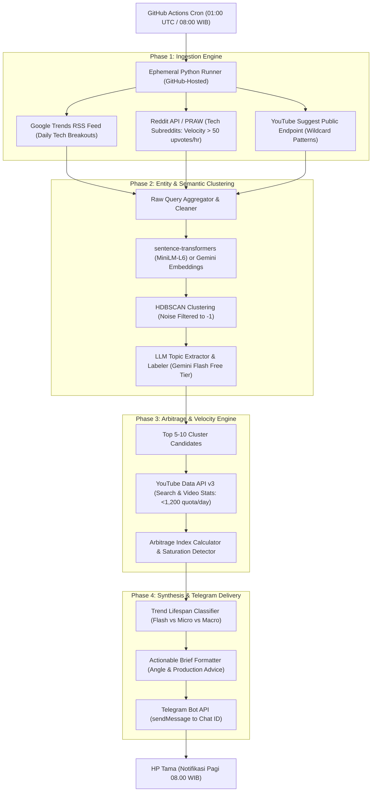
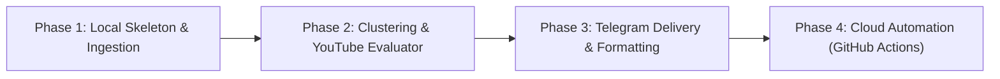

# Architecture & Implementation Plan: YouTube Trend Intelligence Agent (Daily Telegram Bot)

## 1. Executive Summary & Goal
Membangun sistem otomasi intelijen tren konten (Trend Intelligence Agent) yang beroperasi 100% gratis (Zero Cost Architecture). Sistem ini mengekstrak sinyal minat awal (*macro-demand*) dari platform hulu (Reddit, Google Trends, YouTube Autocomplete), memvalidasi saturasi supply versus demand di YouTube, dan mengirimkan ringkasan actionable setiap hari pukul 08.00 WIB via bot Telegram langsung ke ponsel Tama.

---

## 2. System Architecture & Data Flow

---

## 3. Detailed Component Breakdown

### Modul 1: Ingestion Engine (Multi-Platform Upstream)
Tujuan: Menangkap sinyal perbincangan sebelum ramai dicari di YouTube, tanpa terkena blokir atau biaya langganan API.

1. **Google Trends RSS Feed:**
   * Sumber: `https://trends.google.com/trending/rss?geo=ID` dan `geo=US`.
   * Data diambil: Judul berita, query breakout (>500% spike), link rujukan, dan perkiraan volume pencarian.
   * Biaya: 100% Gratis, tanpa auth token, tanpa risiko IP ban.

2. **Reddit PRAW Ingestion:**
   * Target Subreddit: `r/technology`, `r/gadgets`, `r/artificial`, `r/LocalLLaMA`, `r/android`, `r/apple`.
   * Filter Kunci: `listing = hot` dan `new`.
   * Metrik Penentu: *Velocity Index* = `Score / AgeInHours`. Hanya mengambil postingan dengan velocity > 30 upvotes per jam di 3 jam pertama.
   * Biaya: Free tier PRAW (script application type, limit 100 request/menit, kita hanya butuh 6 request per run).

3. **YouTube Suggest Endpoint (Wildcard Crawling):**
   * Endpoint: `https://suggestqueries.google.com/complete/search?client=firefox&ds=yt&q={QUERY}`
   * Pattern:
     * `[Entity] vs *`
     * `kenapa [Entity] *`
     * `cara setting [Entity] *`
     * `[Entity] worth it gak *`
   * Biaya: Publik tanpa token API, zero quota consumption.

---

### Modul 2: Entity Extraction & Semantic Clustering
Tujuan: Mengubah ratusan judul dan frasa mentah yang berisik menjadi kluster topik terstruktur.

1. **Text Normalization & Deduplication:**
   * Pembersihan link, emoji berlebih, tagar sponsor, dan stop words bilingual (Indonesia & Inggris).
2. **Vectorization & Clustering:**
   * Menggunakan model lokal ringan `all-MiniLM-L6-v2` (via `sentence-transformers`) yang berjalan langsung di CPU GitHub Actions (eksekusi <15 detik) atau embedding API Gemini.
   * Algoritma: **HDBSCAN** (`min_cluster_size=3`, `min_samples=2`).
   * Output: Kluster topik valid (cluster `0, 1, 2...`) dan data sampah yang otomatis dibuang ke cluster `-1` (noise).
3. **LLM Topic Labeling:**
   * Untuk tiap kluster valid, kirim 3-5 judul perwakilan terdekat dengan sentroid ke Gemini 1.5 Flash / 2.0 Flash (Free Tier Google AI Studio).
   * Prompt menghasilkan:
     * Nama Topik (3 sampai 5 kata jelas).
     * Pertanyaan/Ketegangan Utama (Core Tension/Question).
     * Entitas hardware/software terkait.

---

### Modul 3: Supply-Demand Arbitrage & Velocity Engine
Tujuan: Memastikan topik yang dipilih memiliki audiens lapar (demand tinggi) tetapi jumlah video pesaing masih minim (supply rendah).

1. **Targeted YouTube API Scanning:**
   * Dari hasil Modul 2, hanya 5 sampai 10 kluster terbaik yang dikirim ke YouTube Data API v3.
   * Search Call: `youtube.search.list(q=TopicName, part='snippet', type='video', order='date', maxResults=15)`.
   * Quota Cost: 10 query x 100 unit = 1.000 unit (dari total jatah gratis 10.000 unit per hari = aman 10%).
2. **The Arbitrage Index Formula:**
   $$\text{Arbitrage Score} = \frac{\text{Demand Weight (Search Signals + Velocity)}}{\text{Supply Saturation (Number of Authority Channels covering the topic)}}$$
   * **Outlier Detection:** Memberikan bobot ekstra jika ditemukan channel kecil (<15K subscribers) yang mendapatkan views melebihi 5x rata-rata subscriber-nya dalam kurun waktu 48 jam terakhir.
3. **Saturation Thresholds:**
   * Jika jumlah upload video baru melonjak tinggi dalam 3 hari terakhir namun median Views Per Hour (VPH) video baru tersebut berada di bawah batas wajar (<100 VPH), tandai topik sebagai **"Saturated / Passing"**.

---

### Modul 4: Categorization & Telegram Notification
Tujuan: Menyusun laporan pagi yang ringkas, berbobot, dan langsung memandu keputusan produksi konten.

1. **Klasifikasi Siklus Hidup Tren:**
   * **Flash (24-48 Jam):** Rekomendasi IG Reels / TikTok / YouTube Shorts (urgensi tinggi, talking-head cepat).
   * **Micro (1-3 Minggu):** Rekomendasi YouTube Long-Form (cocok untuk alur riset dan jadwal mingguan channel Sheggario).
   * **Macro (Bulan):** Rekomendasi ide serial atau sudut pandang baru untuk konten pilar.
2. **Format Pesan Telegram:**
   * Menggunakan MarkdownV2 atau HTML formatting yang bersih.
   * Tanpa tabel kaku, fokus pada *Action Item*, *Angle Cerita*, dan *Data Pendukung*.

---

## 4. Zero-Cost Infrastructure & Deployment Architecture

1. **Telegram Bot Setup:**
   * Registrasi via `@BotFather` -> mendapatkan `TELEGRAM_BOT_TOKEN`.
   * Mengambil ID chat personal Tama via `@userinfobot` -> `TELEGRAM_CHAT_ID`.
2. **GitHub Repository & Secrets:**
   * Simpan script pada repository pribadi (private).
   * Konfigurasi GitHub Repository Secrets:
     * `TELEGRAM_BOT_TOKEN`
     * `TELEGRAM_CHAT_ID`
     * `GEMINI_API_KEY` (Google AI Studio Free Tier)
     * `YOUTUBE_API_KEY` (Google Cloud Console Free Tier)
     * `REDDIT_CLIENT_ID` & `REDDIT_CLIENT_SECRET` (PRAW Script App)
3. **GitHub Actions Workflow File (`.github/workflows/daily_trend.yml`):**
   * Jadwal Cron: `0 1 * * *` (Pukul 01.00 UTC = 08.00 WIB).
   * Trigger Manual: `workflow_dispatch` (bisa di-test kapan saja dari browser atau HP tanpa menunggu jam 8).
   * Durasi eksekusi: ~2 menit per hari (total ~60 menit per bulan dari kuota gratis 2.000 menit).

---

## 5. Step-by-Step Implementation Roadmap

*   **Phase 1: Local Ingestion Skeleton**
    *   Buat `trend_agent/ingestors/`: modul Google Trends RSS, Reddit PRAW, dan YouTube Suggest.
    *   Verifikasi data mentah berhasil ditarik secara lokal tanpa error network.
*   **Phase 2: Clustering & Scoring Engine**
    *   Integrasi `sentence-transformers` + `HDBSCAN` untuk pengelompokan judul.
    *   Integrasi Gemini Flash API untuk topic labeling dan reasoning angle.
    *   Integrasi YouTube Data API v3 untuk kalkulasi Arbitrage Index.
*   **Phase 3: Telegram Notifier & Formatter**
    *   Buat modul pengirim pesan via Telegram Bot API (`requests.post`).
    *   Uji coba pengiriman laporan terformat ke akun Telegram Tama.
*   **Phase 4: GitHub Actions Deployment & Verification**
    *   Susun file workflow `.github/workflows/daily_trend.yml`.
    *   Upload kode ke repository GitHub (private).
    *   Set GitHub Secrets.
    *   Uji coba run manual via tombol `Run Workflow` dan pastikan pesan sukses masuk jam itu juga.

---

## 6. Risk Management & Defensive Design

1. **GitHub Actions Cron Delay:**
   * *Risiko:* Cron pada GitHub Actions publik terkadang mengalami jeda antrean (queue lag) antara 5 sampai 20 menit saat jam sibuk server global.
   * *Mitigasi:* Workflow dijadwalkan pukul `00:50 UTC` (~07:50 WIB) agar pesan dipastikan tiba tepat atau sedikit sebelum pukul 08:00 WIB.
2. **Reddit / Network Rate Limits:**
   * *Mitigasi:* Wrap semua panggilan API dalam blok `try-except` dengan retry ber-delay eksponensial (backoff), dan sediakan graceful fallback (jika Reddit gagal, pipeline tetap berjalan menggunakan Google Trends dan YouTube Suggest).
3. **YouTube API Quota Burn:**
   * *Mitigasi:* Pasang hard limit di dalam kode: maksimal 10 search query per eksekusi. Catat penggunaan kuota di log runner.
4. **LLM Hallucination Safeguard:**
   * *Mitigasi:* LLM hanya digunakan untuk sintesis dan penamaan topik dari data riil yang sudah terkumpul di kluster, bukan untuk mengarang nama gadget atau data statistik sendiri.

---

## 7. Deliverables Checklist
- [x] `plan.md` (Dokumen panduan arsitektur dan eksekusi komprehensif)
- [x] `requirements.txt` (Daftar dependensi Python minimal dan ringan)
- [x] `main.py` & modul di `trend_agent/` (Script terintegrasi siap jalan)
- [x] `.github/workflows/daily_trend.yml` (Script cron scheduler gratis)
- [x] Integrasi Telegram Bot (@LisaaWriter_bot) & Google APIs (Berhasil dites terkirim)
